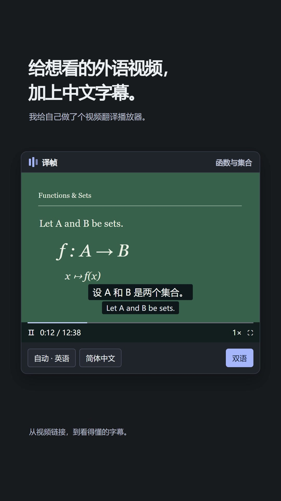

# 译帧 · 本地视频字幕翻译

把想看的视频，变成看得懂的视频。

译帧是一个在 **Windows 本机运行、通过浏览器使用**的视频字幕工具。导入视频链接或本地文件，在电脑上识别对白，再按需翻译；也可以只看原文、查词和收藏生词。

## 一分钟看看它能做什么

[](https://xxsdd.github.io/yizhen-video-translator/)

**[观看宣传视频](https://xxsdd.github.io/yizhen-video-translator/)** · **[下载原版 MP4](https://github.com/xxsdd/yizhen-video-translator/releases/download/v0.1.0-preview/yizhen-promo.mp4)**

60 秒 / 1080 × 1920 / 无旁白。视频是根据产品界面制作的动画演示，进度经过加速，不代表实际下载或识别耗时。部分界面早于最新版本；目前导入后由用户手动开始下载和处理。素材说明见 [视频署名](docs/media/CREDITS.md)。

## 主要功能

- **链接或本地文件导入**：每批最多 10 个独立视频，单个最长 3 小时。通过 yt-dlp 获取支持的网站，默认选择最高可用画质。
- **Chrome 一键导入**：点击扩展检测当前页面；只有一个候选时直接导入，多个候选时选择需要的视频。
- **自己控制任务**：导入后等待操作；开始/暂停下载、开始/暂停处理、优先处理其他视频。右键重命名、删除，支持批量删除。
- **本地识别对白**：faster-whisper，可选择 NVIDIA GPU 或 CPU。中文识别原文在本地转为简体；可复检遗漏对白、右键编辑字幕。
- **点击才翻译**：支持 DeepSeek、OpenAI 兼容 API、智谱和自定义服务。已保存的译文可续用，重试只补翻缺失部分。
- **可选 Codex 本机接入**：检测本机官方 Codex 登录，读取模型和思考强度。此功能依赖本机 CLI 版本、账号权限和实际额度；不可用时明确报错，不自动改走付费 API。
- **看字幕，也能学英语**：仅译文、双语、原文、关闭字幕；关闭画面字幕时，下方字幕稿仍显示原文。英文查词与本地生词收藏、字幕搜索、SRT/VTT 导出。
- **调整观看方式**：深浅主题、全屏、倍速；悬停字幕后拖动位置、调整字号，保存观看进度。
- **自己挑封面**：下载完成后随机抽取 5 张画面，点选保存，也可以换一批。

## Windows 一键安装

**[下载安装包 · Windows x64](https://github.com/xxsdd/yizhen-video-translator/releases/download/v0.1.1/Yizhen-Setup-0.1.1-Windows-x64.exe)** · [发布说明与 SHA256 校验](https://github.com/xxsdd/yizhen-video-translator/releases/tag/v0.1.1)

下载安装 EXE，选择位置并完成安装，然后双击桌面「译帧」。安装包约 1.3 GB，安装后约占 3 GB；包含独立 Python、FFmpeg、CPU/NVIDIA GPU 识别依赖和英汉词典，无需手动配置开发环境。

首次打开后，在设置中选择识别模型并点击「准备模型」，需联网下载，large-v3 另需约 3 GB。新安装默认使用 CPU；有兼容 NVIDIA 显卡时可在设置中切换 GPU，显卡驱动需由系统提供。翻译仍使用你自己配置的服务或可用额度。

安装版数据保存在安装目录的 `data/`，卸载会保留本地数据。安装包尚未代码签名，发布页提供 SHA256 校验值。当前为预览版本，已在本机的独立安装目录验证，不代表所有 Windows 配置都已测试。

## 从源码运行（开发者）

需要：Windows 10/11、Python 3.12、[uv](https://docs.astral.sh/uv/)、[FFmpeg](https://ffmpeg.org/download.html)（包含 `ffprobe`，加入 PATH）。使用 GPU 识别还需要兼容的 NVIDIA 驱动；没有适用 GPU 可在设置中选 CPU。

```powershell
git clone https://github.com/xxsdd/yizhen-video-translator.git
cd yizhen-video-translator
powershell -NoProfile -ExecutionPolicy Bypass -File .\安装环境.ps1
```

安装脚本创建 `.venv`、安装锁定依赖，并准备本地英汉词典。识别模型不包含在仓库中，首次使用需联网下载；large-v3 约为数 GB，请预留磁盘空间。

安装后双击 **启动译帧.cmd**，浏览器访问 **http://127.0.0.1:8765/**。

如果虚拟环境的启动器报 `No Python at …`，可使用独立安装的 Python 运行标准库启动器：

```powershell
python -X utf8 start.py
```

`start.py` 通过 `runtime.json` 选择后台服务解释器，健康检查通过后打开浏览器。虚拟环境本身必须有效；换电脑后请重新安装环境，不要直接复制 `.venv`。

## 使用顺序

1. 添加视频链接、本地文件，或从 Chrome 扩展导入。
2. 网页视频点击「开始下载」，完成后点击「开始处理」；本地文件可直接开始处理。
3. 在设置中准备识别模型，选择适合自己电脑的识别和视频转换设备。
4. 原文识别完成后可以直接观看；需要译文时选择目标语言，配置翻译服务并手动点击「开始翻译」。
5. 右键侧边栏视频或点「•••」可重命名、选择封面、暂停或删除；右键字幕稿可编辑。

Chrome 扩展安装：打开 `chrome://extensions` → 开启开发者模式 →「加载已解压的扩展程序」→ 选择本项目的 `chrome-extension` 文件夹。详见 [扩展使用说明](chrome-extension/README.md)。

## 数据与费用

视频、音频、识别模型、字幕、观看记录、生词和设置保存在本机 `data/` 中。语音识别在本机完成；文本翻译会将字幕及必要上下文发送到你选择的服务。

保存设置、导入视频和挑选封面不会调用翻译模型。点击「开始翻译」「测试翻译连接」或 AI 例句解释时才发起相应请求，按服务实际规则消耗额度或计费。API Key 在 Windows 当前用户下加密保存。

仓库不包含运行时数据、模型、登录凭据、API Key 或个人视频库。服务默认只监听 `127.0.0.1`，请勿直接作为公网服务部署。

## 能力边界

- 网站是否能下载取决于 yt-dlp 提取器、链接有效性和网站限制；登录要求、DRM、地区限制等可能导致失败。可以改用本地文件。
- 不保证识别每一句对白，也不能完全避免噪声引起的误识别；可以指定原语言、复检遗漏或手动编辑。
- 语音识别不等于 OCR，不会提取画面中的文字；本项目也不生成配音。
- 暂停会停止后续处理并保留检查点，不保证每个媒体步骤都能按字节无缝续接。第三方服务已产生的用量不能通过取消撤回。

## 技术与验证

Python / FastAPI / SQLite · FFmpeg · yt-dlp · faster-whisper · OpenCC · 原生 HTML/CSS/JavaScript · Chrome Manifest V3。

```powershell
.\.venv\Scripts\python.exe -X utf8 -m pytest -q
```

本次发布前本地 **120 项测试通过**。测试使用独立临时数据目录，覆盖任务控制、翻译续传、字幕编辑、封面抽帧、简体转换等；另外验证了浏览器端字幕显示切换和封面选择。测试通过不代表所有网站、GPU 或第三方模型都已验证。

[第三方组件与素材说明](THIRD_PARTY_NOTICES.md)
